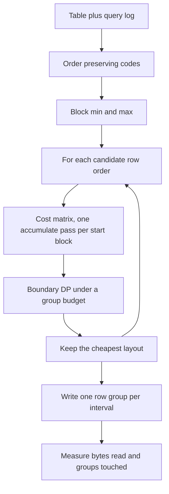
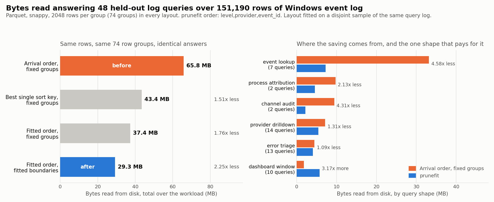

# prunefit

Fit a Parquet row-group layout to the query log that will scan it.

## The problem

A Parquet reader skips a row group when a predicate interval misses that group's
min and max statistics. Whether that happens is decided entirely by which rows
ended up sharing a group, and the only control a writer gives you is
`row_group_size`: a row count. Rows land in arrival order, boundaries fall every
N rows, and the statistics are whatever that accident produces.

On a log table the accident is expensive. Events arrive interleaved, so every
row group holds a little of every provider, every level and every event id. The
min and max for those columns span almost the whole domain in almost every
group, so a filter on any of them prunes nothing at all and the reader walks the
entire file. In the measurement below, a filter on a single event id read
33.2 MB out of a 5.1 MB file (the same groups, repeatedly, across seven
queries): not one row group was skipped.

Table formats help a bit and stop short. Delta and Iceberg let you declare a
sort order or a Z-order key, but the boundaries are still cut at a fixed row
count, and the key is chosen by hand rather than derived from the queries that
will actually run.

## What it does

`prunefit` takes a Parquet file and a query log, and writes a new Parquet file
with the same schema, the same rows and the same answers, laid out so the
reader can skip more of it.

1. Every predicate column is replaced by order preserving int64 codes, so
   strings, timestamps and integers all reduce to the same interval test the
   reader performs.
2. Rows are chunked into blocks, and each block keeps a min and a max per
   column. Blocks are the atoms of the search, which caps it at
   O(blocks squared) instead of O(rows squared).
3. Candidate row orders are enumerated: arrival order, every short permutation
   of the hot predicate columns, and hierarchical orders such as
   `ts~7d, provider, ts` that keep week level time pruning while clustering each
   week by provider.
4. For each candidate, the row-group boundaries are solved exactly by a dynamic
   program, under a budget of at most as many groups as the baseline writer
   would have produced.
5. The best layout is written out, one row group per chosen interval.

The same package measures the result: bytes actually pulled off disk, row
groups touched, and wall time, per query.

## Why it is interesting

**The cost matrix collapses.** A row group is scanned unless some predicate
interval misses its statistics, and growing a group only widens those
statistics. So the set of queries that scan a group is monotone in the group
interval: once a query matches the run starting at block i, it matches every
longer run from i. That turns the whole cost matrix into one accumulate pass per
start block, which is what makes the exact program affordable and removes any
reason to reach for a heuristic. `tests/test_layout.py` checks the dynamic
program against brute force enumeration over every legal partition.

**Where the boundaries fall is worth real money.** The usual advice stops at
"sort your data". Sorting by the single best key cut bytes read by 1.51x here,
and the fitted multi-column order got to 1.76x, but both leave the boundaries on
a fixed grid. Solving for the boundaries on top of the same row order took it to
2.25x. That last step is the part no writer exposes.

**The baseline is inside the search space.** Arrival order with fixed groups is
evaluated as a candidate, so the fitted layout can never model worse than the
layout you already have. The reported numbers are measured on a held-out sample
of the query log that the layout was not fitted to.

**Nothing downstream changes.** The output is a plain Parquet file. No table
format, no manifest, no reader patch, no schema change. Every query in the
benchmark returns byte identical row counts from every layout, and the demo
fails loudly if that ever stops being true.

## Architecture

[FigJam board: prunefit architecture](https://www.figma.com/board/KliHrjrZgjvWJRGf4t19xn)

The board shows the path from a Parquet table and a query log through code
encoding, block statistics, order search and the boundary program, to the
written file and the measurement harness that checks it.



## Results



The metric is bytes actually read off disk to answer a workload of 48 held-out
queries over 151,190 rows of this machine's own Windows event logs. Bytes are
counted by wrapping the file in a counting reader, so the number is what pyarrow
pulled, not an estimate. The baseline is what a Parquet writer produces today:
arrival order (the order the events landed in), fixed 2,048 row groups, 74 row
groups in total. Every other layout in the chart holds the row count, the
column set, the compression codec and the row-group count fixed at exactly those
values, so the only variable is which rows share a group.

| Layout | File | Bytes read | Row groups scanned | Rows scanned | Time |
|---|---|---|---|---|---|
| Arrival order, fixed groups (baseline) | 5.06 MB | 65.75 MB | 828 | 1,691,762 | 710 ms |
| Best single sort key, fixed groups | 4.09 MB | 43.42 MB | 752 | 1,531,408 | 560 ms |
| Fitted order, fixed groups | 4.09 MB | 37.36 MB | 706 | 1,445,888 | 515 ms |
| **prunefit, fitted order and boundaries** | **4.04 MB** | **29.26 MB** | **777** | **1,104,896** | **515 ms** |

Bytes read fall 55.5 percent, a 2.25x reduction, and the workload runs 1.38x
faster. The win decomposes honestly into two parts: each query touches a smaller
share of the file (down from 27.1 percent of it on average to 15.1 percent, a
1.80x improvement), and clustering similar rows together also
compresses better, which shrinks the file itself from 5.06 MB to 4.04 MB
(1.25x). Multiplying the two gives the 2.25x. The purely structural number, rows
that a statistics-pruning reader still has to decode, improves 1.53x.

The right panel shows the trade the fit chose. Event id lookups improve 4.58x
and channel audits 4.31x, because those columns are now clustered. Dashboard
queries over a one day window get 3.17x worse, because abandoning strict time
order costs them their pruning. The search accepted that because dashboard
windows were 1.81 MB of a 65.75 MB workload while event id lookups were
33.16 MB, which is the kind of balance a hand-picked sort key has no way to
strike.

### What these numbers do not say

- The layout is fitted to a query log. A workload that shifts away from the
  fitted one loses the benefit, and in the limit (only time-window dashboards)
  arrival order is already optimal and prunefit returns it.
- Fitting is a write-time or compaction-time cost: 12.2 seconds here for 68
  candidate orders over 151,190 rows. It is not on the read path.
- The cost model charges a group by its row count times a per-column byte share
  taken from the source file. It does not model per-group compression, which is
  why the model and the measurement are reported separately: the model picks the
  layout, the measurement decides whether it was right.
- Row-group count is held equal on purpose. Simply writing more, smaller row
  groups also improves pruning, and that is available to the baseline too, so it
  is controlled for rather than claimed.

## How to run it

```bash
pip install -r requirements.txt

# 1. Build the source table. On Windows this reads the machine's own event logs
#    through wevtutil. Elsewhere it generates a table with the same shape.
python examples/build_event_dataset.py --out data/events_source.parquet

# 2. Fit, write four layouts, measure them on held-out queries, record results.
python examples/run_demo.py

# 3. Redraw the chart from the recorded numbers.
python docs/make_chart.py

# 4. Tests, including the dynamic program against brute force enumeration.
python -m pytest tests -q
```

Using it on your own table and your own queries:

```bash
# Draw a query log from the table's values, or hand-write the same JSON.
python -m prunefit sample-workload --input mytable.parquet --out workload.json

# Rank candidate orders without writing anything.
python -m prunefit explain --input mytable.parquet --workload workload.json

# Fit and write.
python -m prunefit fit --input mytable.parquet --workload workload.json \
    --out fitted.parquet --baseline-out baseline.parquet --rows-per-group 2048

# Measure both.
python -m prunefit bench --workload workload.json \
    --layout baseline=baseline.parquet --layout prunefit=fitted.parquet
```

A query log is plain JSON, so a real one can be exported from query history:

```json
{"queries": [
  {"name": "q000", "template": "provider_drilldown", "weight": 1.0,
   "predicates": [
     {"column": "provider", "op": "eq", "value": "Microsoft-Windows-Store"},
     {"column": "ts", "op": "range", "lo": "2026-09-01T00:00:00",
      "hi": "2026-09-15T00:00:00"}]}
]}
```

## Example output

`python examples/run_demo.py`, on the machine described at the end:

```
source data/events_source.parquet: 151190 rows, 5719444 bytes
fit: order=level,provider,event_id groups=74 budget=74 in 12.2s over 68 candidate orders
modeled bytes scanned: baseline 90.3 MB to fitted 34.6 MB
  A_arrival_fixed      5061232 bytes   74 row groups
  B_sorted_fixed       4091634 bytes   74 row groups
  C_fitorder_fixed     4088036 bytes   74 row groups
  D_prunefit           4044727 bytes   74 row groups
measured 48 held-out queries on 4 layouts in 16.2s

layout                                  file MB  read MB  groups       ms  factor
Arrival order, fixed groups                5.06    65.75     828    710.1   1.00x
Best single sort key, fixed groups         4.09    43.42     752    559.8   1.51x
Fitted order, fixed groups                 4.09    37.36     706    515.5   1.76x
prunefit: fitted order and boundaries      4.04    29.26     777    514.7   2.25x
```

`python -m prunefit explain`, ranking candidate orders by modeled bytes:

```
order                                   modeled MB  groups
level,provider,event_id                       34.6      74
provider,level,event_id                       34.6      74
provider,event_id                             34.7      74
provider,event_id,ts                          34.7      74
provider,event_id,level                       34.7      74
provider,level                                39.5      74
provider,level,ts                             39.5      74
level,provider                                39.6      74

baseline (arrival order, fixed groups): 90.3 MB modeled
arrival order with fitted boundaries:   87.1 MB modeled
```

68 orders were scored. Arrival order ranks 58th at 87.1 MB modeled, and the
best hierarchical candidate, `ts~30d, level, event_id, ts`, ranks 10th at
41.3 MB: on this query log flat clustering beats keeping month level time
locality, which is a fact about this workload rather than a rule.

The fitted layout keeps 74 row groups, but their sizes now run from 1,024 to
15,360 rows: the program spends groups where the statistics are worth splitting
and merges the stretches where they are not.

`python -m pytest tests -q`:

```
.............                                                            [100%]
13 passed in 1.81s
```

## Project layout

```
prunefit/
  encode.py     order preserving codes for strings, timestamps and integers
  stats.py      per block min and max, the atoms of the search
  layout.py     cost matrix and the exact boundary dynamic program
  keys.py       sort key specs, including coarsened time keys like ts~7d
  search.py     candidate orders, each scored by the boundary program
  writer.py     write one row group per chosen interval
  measure.py    counting reader, row-group pruning check, timing
  generate.py   sample a query log from a table's own values
  cli.py        sample-workload, explain, fit, bench
examples/
  build_event_dataset.py   real Windows event logs, or a synthetic stand in
  run_demo.py              fit, write four layouts, measure, record
docs/
  make_chart.py            render before_after.png from results.json
  results.json             every measured number behind the chart
tests/                     dynamic program against brute force, and end to end
```

Measured on Windows 11, Python 3.13.5, pyarrow 21.0.0, snappy compression,
timings taken as the minimum of five interleaved repeats per query so that
machine drift cannot favour one layout. All numbers in this README come from
`docs/results.json`, written by the demo run above.
